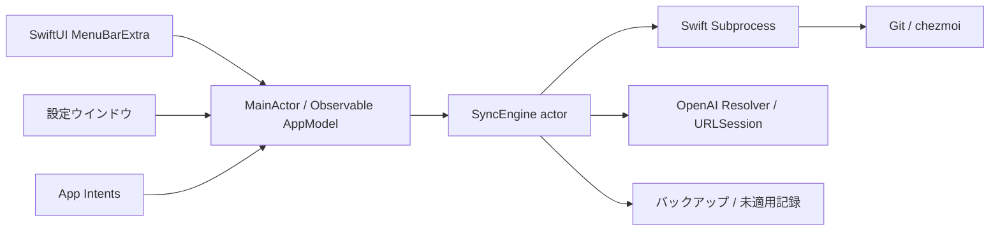

# macOS 27 専用設計

0.2.0 は Apple Silicon / macOS 27 以降を対象とし、Xcode 27.1・Swift 6.4 で構築します。Intel 向けコードと古い OS 向けの分岐を含めません。Apple Intelligence / Foundation Models は使用せず、AI 解決は従来の OpenAI API と保存済みモデル設定を使用します。

## 状態と非同期処理

UI は `@MainActor @Observable` な共有モデルを参照します。メニュー・ウインドウ・App Intents が同じ実行タスクと busy guard を使うため、重複開始を拒否できます。エンジンも actor と操作中フラグを持ち、await で再入しても重複操作を拒否します。別プロセスの Chezmoi Menu は source 内の flock で排他します。

Git / chezmoi は Swift Subprocess の非同期パイプで実行します。UI スレッドでの polling / sleep は使用しません。標準出力・標準エラーの取得量を制限し、履歴には生出力を載せません。同期テストの環境構築だけは従来の同期型ヘルパーを使用します。

## 停止の境界

Swift 6.4 の `withTaskCancellationShield` を使用し、re-add・add・commit・merge・apply・push がユーザー操作で途中終了しないようにします。Subprocess 内の子タスクへのキャンセル伝播を分離するため、変更コマンドは所有する独立タスクを生成し、その完了を必ず await します。読み取り、fetch、AI 待機はキャンセル可能です。子プロセスは独立したセッションに配置し、中断時はプロセスグループへシグナルを送ります。通常のコマンドには 120 秒のタイムアウトを別途設けます。

非同期 `defer` と cancellation shield により、キャンセル後も merge の中止処理を待ちます。取り込み済みコミットを残し、統合が完了していなければ未適用記録の解除を試みます。merge 開始前から未適用記録を保存するため、統合直後に停止しても次回の re-add が統合結果を置き換えません。apply 成功後に記録を削除します。

これはファイルシステム全体のトランザクションではありません。異常終了・外部ツールの失敗・タイムアウトや外部クライアントの操作は、バックアップと [復旧手順](RECOVERY.md) で対処します。

## UI とシステム連携

`MenuBarExtra` の window style で進捗と停止を表示します。設定は NavigationSplitView で同期・差分・一般・OpenAI・履歴を切り替えます。ボタンは標準の glass スタイルを使用します。

App Intents は同期と同じ経路を呼び、処理完了まで待って結果を返します。手動実行の支援であり、常時監視や定期同期は追加しません。配布時は `appintentsmetadataprocessor` でメタデータを同梱します。

アイコンは Icon Composer の家・鍵穴レイヤーと明暗バリエーションから `actool` で構築します。設定 JSON の形式、Application Support の保存先、Keychain の service / account は維持し、移行のためのキー再入力は不要です。

参考: [SE-0504 Task Cancellation Shields](https://github.com/swiftlang/swift-evolution/blob/main/proposals/0504-task-cancellation-shields.md)、[Swift Subprocess](https://github.com/swiftlang/swift-subprocess)、[Apple Icon Composer](https://developer.apple.com/icon-composer/)。
